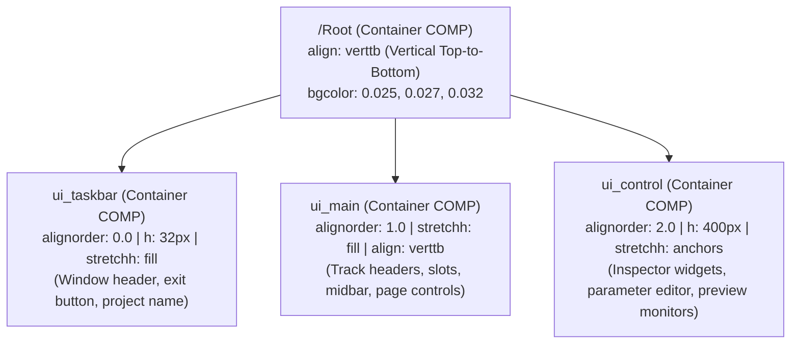

> **Adaptación Hermes.** Estas skills son del toolkit especializado de UI de TouchDesigner para agentes TDMCP/Hermes.
> En Hermes las tools de TDMCP se llaman con el prefijo o acceso nativo (`execute_code`, `get_help`, `create_operator`, `wiring`, `build_network`).
> Cargá **`td-general` primero** en cualquier tarea de TouchDesigner.

---

# TouchDesigner Modern UI/UX Design System — AAVJ Standard

This skill encapsulates the comprehensive UI/UX architecture, visual tokens, layout patterns, and performance contracts extracted from **AAVJ Beta** (`AAVJ_BETA_v1.26b`) and implemented in the **TouchDesigner Multi-Layer Timeline (TD-MTL)**. Use this skill to design, restyle, or build sleek, high-density, pro audio-visual DAW interfaces in TouchDesigner 2025+ (Vulkan render pipeline).

---

## 1. Visual Identity & Aesthetic Principles

Professional creative software (Ableton Live, Bitwig Studio, Resolume Arena, Disguise) follows strict design standards for low fatigue and high density during 12+ hour production sessions:

- **Deep Slate Canvas:** Backgrounds avoid pure pitch black (`#000000`) and instead use micro-tuned dark slates (`0.025, 0.027, 0.032` / `#060708` to `0.045, 0.048, 0.055` / `#0b0c0e`).
- **Subtle 1px Geometric Borders:** Sharp, fine outline borders (`0.12, 0.13, 0.15, 0.6`) separate panels without creating heavy cognitive weight.
- **Micro-Contrast Accents:** Interactive active states use an elegant muted cyan/teal (`0.3276, 0.4719, 0.5200` / `#537885`) and subtle rollovers (`0.28, 0.46, 0.54`), reserving aggressive bright colors only for warnings (`warning_red` `#d92e2e`).
- **Typography of Choice:** **`Bahnschrift Condensed`** (native variable font on Windows 10/11) delivers ultra-clean horizontal compactness, allowing dense parameter naming and labels without text clipping.
- **Vector Icon Glyphs:** Instead of loading dozens of PNG textures into VRAM, vector glyph fonts (`Material Design Icons` or `Segoe UI Symbol`) are used in `textCOMP`s via Unicode codepoints (`\U000f012c`, `✂`, `▶`, `⏸`, `⏹`).

---

## 2. Centralized Color Token Engine (`/ui/colors`)

Never hardcode arbitrary RGB colors across individual panels. Maintain a centralized design token repository at `/ui/colors` (or `/project_root/UI/colors`).

### Semantic Token Palette

```python
AAVJ_PALETTE = {
    # --- Canvas & Panels ---
    'panel_bg':         (0.025, 0.027, 0.032, 1.0),   # Deepest container canvas (#060708)
    'panel_base':       (0.045, 0.048, 0.055, 0.98),  # Standard panel card background (#0b0c0e)
    'panel_header':     (0.055, 0.060, 0.070, 1.0),   # Toolbar / header strip background (#0e0f12)
    'panel_roll':       (0.075, 0.082, 0.095, 1.0),   # Panel hover / rollover state
    'panel_active':     (0.100, 0.110, 0.130, 1.0),   # Panel active / selected state

    # --- Typography ---
    'text_static':      (0.680, 0.700, 0.720, 1.0),   # Default readable label text (#adafb3)
    'text_roll':        (1.000, 1.000, 1.000, 1.0),   # Hover highlighted text (pure white)
    'text_active':      (0.920, 0.950, 0.980, 1.0),   # Active control label text
    'text_dim':         (0.420, 0.440, 0.460, 1.0),   # Secondary / subtle text (#6b7075)
    'text_edit':        (0.200, 0.700, 0.900, 1.0),   # Inline field editing text

    # --- Borders & Outlines ---
    'outline_static':   (0.120, 0.130, 0.150, 0.6),   # Default 1px subtle separation border
    'outline_roll':     (0.280, 0.320, 0.360, 0.8),   # Rollover border highlight
    'outline_active':   (0.328, 0.472, 0.520, 1.0),   # Active border accent (Cyan)

    # --- Buttons & Controls ---
    'button_off':       (0.070, 0.075, 0.085, 0.85),  # Inactive button face
    'button_offroll':   (0.110, 0.120, 0.135, 0.95),  # Inactive button hover
    'button_on':        (0.220, 0.380, 0.450, 1.0),   # Active / Toggled button face (Muted Teal)
    'button_onroll':    (0.280, 0.460, 0.540, 1.0),   # Active button hover
    'button_accent':    (0.328, 0.472, 0.520, 1.0),   # Primary accent (Play / GO)

    # --- Sliders & Meters ---
    'slider_base':      (0.025, 0.027, 0.032, 1.0),   # Slider track background
    'slider_fill':      (0.280, 0.420, 0.480, 0.9),   # Slider filled level
    'slider_knob':      (0.700, 0.750, 0.800, 1.0),   # Slider thumb / knob
    'warning_red':      (0.850, 0.180, 0.180, 1.0),   # Alert / Mute / Error (#d92e2e)
    'solo_gold':        (0.920, 0.720, 0.150, 1.0),   # Solo state highlight (#ebb826)
    'marker_cyan':      (0.000, 0.850, 0.950, 1.0),   # Marker color (#00d9f2)
}
```

### Implementing the Token Store in TouchDesigner

Create a `baseCOMP` `/ui/colors` containing:
1. `tableDAT:table_colors` with columns `[name, r, g, b, a, hex]`.
2. `nullDAT:out` connected from `table_colors`.
3. An extension `ColorsExt` providing helper methods:
   ```python
   class ColorsExt:
       def __init__(self, ownerComp):
           self.ownerComp = ownerComp
       def Color(self, name):
           t = self.ownerComp.op('table_colors')
           if t and t[name, 'r'] is not None:
               return (float(t[name, 'r']), float(t[name, 'g']), float(t[name, 'b']), float(t[name, 'a']))
           return (0.5, 0.5, 0.5, 1.0)
       def R(self, name): return self.Color(name)[0]
       def G(self, name): return self.Color(name)[1]
       def B(self, name): return self.Color(name)[2]
       def A(self, name): return self.Color(name)[3]
   ```
4. Panel bindings via DAT expressions or extension:
   ```python
   op('/ui/colors/out')['panel_base', 'r'].val
   # or
   op('/ui/colors').Color('panel_base')
   ```

---

## 3. Responsive Layout Hierarchy (Flexbox Patterns in TouchDesigner)

AAVJ structures its main application window (`/AAVJ`) using procedural Container COMP alignments:



### Layout Alignment Rules
- **Vertical Stacks (`align = verttb`):** Order children strictly via `alignorder` (`0.0, 1.0, 2.0`). Never rely on spatial node coordinates.
- **Horizontal Strips (`align = horizlr`):** Used inside layer rows:
  - Left Sidebar / Header (`layerctrl`): Fixed width `w = 400`, `alignorder = 0.0`.
  - Clip Slots Strip (`slots`): `stretchw = fill`, `alignorder = 1.0`.
- **Responsive Stretches (`stretchh`, `stretchw`):**
  - Set `stretchh = fill` for panels that must adapt dynamically to window resizing.
  - Set `stretchh = fixed` (or `stretchw = fixed`) for standard toolbars (`h = 32px` or `40px`) and layer strips (`h = 96px`).

---

## 4. Hardware-Accelerated GLSL UI Shaders (`glslmultiTOP`)

Rather than compositing buttons with heavy TOP chains (Over, Level, Crop, Text), AAVJ uses a **single lightweight GLSL pixel shader** inside each button/slot (`ctrl/glslmulti1`):

### The AAVJ Interactive Button Shader (`glslmulti_pixel`)

```glsl
// AAVJ Interactive Slot / Button Shader
uniform int uState;          // 1 when actively playing / toggled, 0 otherwise
uniform int uHover;          // 1 on mouse rollover, 0 otherwise
uniform int uFocus;          // 1 when selected/focused, 0 otherwise
uniform int uLinkMode;       // 1 if in linking/routing mode
uniform int uLinked;         // 1 if currently linked
uniform vec4 uDefColor;      // Inactive background color
uniform vec4 uActiveColor;   // Active / Play color
uniform vec4 uLinkColor;     // Routing accent color

out vec4 fragColor;

void main()
{
    vec4 DefColor = uDefColor;
    vec4 ActiveColor = uActiveColor;
    vec4 LinkColor = uLinkColor;
    
    // Sample thumbnail (Input 0) at 80% brightness
    vec4 Thumb = texture(sTD2DInputs[0], vUV.st) * 0.8;
    
    vec4 StateColor = DefColor;
    StateColor += float(uState) * (ActiveColor * 0.3) + Thumb; 
    LinkColor = mix(LinkColor * 0.2, LinkColor * 0.8, float(uLinked)) + Thumb;
    
    vec4 AAoutput = mix(StateColor, LinkColor, float(uLinkMode));
    
    // Instant hover brightening without CPU panel cook
    AAoutput += AAoutput * (float(uHover) * 0.25);
    
    fragColor = TDOutputSwizzle(AAoutput);
}
```

### Why This Outperforms Traditional TD Buttons
1. **Zero Texture Reallocations:** The shader renders into a fixed thumbnail texture (`95x95` or `128x128`).
2. **Instant Rollover:** `uHover` updates a uniform float; no TOP re-cooking is triggered.
3. **GPU Compositing:** State color tint, thumbnail, and hover are resolved in a single render pass.

---

## 5. Control & Widget Architecture

### A. Modern Dropdown Menu Widget (`dropDownMenu`)
- **Widget Type:** TouchDesigner `widget` COMP (`dropDownMenu`).
- **Key Parameters:**
  - `Font`: `Bahnschrift Condensed`
  - `Labelfontsize`: `12pt`, `Labelfontfraction`: `0.689`
  - `Menubuttononfacecolor`: `(0.220, 0.380, 0.450, 1.0)` (Cyan accent)
  - `Menubuttonofffacecolor`: `(0.070, 0.075, 0.085, 0.85)`
  - `Menubgcolor`: `(0.025, 0.027, 0.032, 1.0)`
  - `Menurollcolor`: `(0.280, 0.320, 0.360, 1.0)` at `0.35` opacity
  - `h`: `30px` (standard control height)

### B. Vertical Level Slider (`level`)
- **Widget Type:** `sliderCOMP` (`w = 40`, `h = 100`).
- **Internal Components:**
  - `ctrl`: Contains GLSL level bar or slider shape.
  - `null_val`: Evaluates normalized output float (`0.0`–`1.0`).
  - Background: Transparent (`bgalpha = 0.0`), allowing layer card background to show through.

### C. Output Preview Monitor with Checkerboard
- **Widget Type:** `containerCOMP` with `topfill = best` (Fit Best aspect ratio).
- **Internal Chain:**
  1. `select_output`: Selects target `out1` or `out2` TOP.
  2. `checker (base)`: Procedural black-and-dark-gray checkerboard pattern (`16x16px`) indicating transparency.
  3. `comp1 (compTOP)`: Composites output over checkerboard (`operation = over`).
  4. `fit1 (fitTOP)`: Fits to container aspect ratio without stretching or distortion.
  5. `null_bg`: Wired directly to parent's `top` parameter.

### D. Real-Time Telemetry HUD (`container_GPUStats`)
- Monospace real-time monitor on the transport toolbar:
  - `performCHOP` sampling `cookrate`, `msec`, `gpu_mem_used`, and `total_gpu_mem`.
  - Line 1: `text_fps` → `f"{op('null_perf')['cookrate'].eval():0.1f} FPS  {op('null_perf')['msec'].eval():0.1f}ms"`
  - Line 2: `text_vram` → `f"VRAM {(op('null_perf')['gpu_mem_used'].eval() / max(1.0, op('null_perf')['total_gpu_mem'].eval()) * 100):0.0f}% ({op('null_perf')['gpu_mem_used'].eval()/1024:0.1f}G)"`
  - Alert Color Expression: switches to `warning_red` (`#d92e2e`) if `gpu_mem_used / total_gpu_mem > 0.85`.

---

## 6. Dynamic VRAM Collapsing & Expansion Engine

In projects with 50+ media cues or generative scenes, leaving all textures, renderTOPs, and geometry active exhausts GPU VRAM and slows cook times. AAVJ solves this with an automatic VRAM Collapsing Engine (`vram_cleanup`):

### Deactivation (When Cue Leaves Playback)
When a clip stops or is replaced:
1. All `renderTOP`s are collapsed from full resolution down to `1x1` px.
2. All `inTOP`s are switched to `outputresolution = 'eighth'`.
3. All inner `TOP`s and `geometryCOMP`s are bypassed (`bypass = True`).
4. Force a single cook so the Vulkan driver frees the VRAM allocations:

```python
def deactivateCue(target_network):
    """Collapses VRAM footprint for an inactive cue / scene."""
    if not target_network or not getattr(target_network, 'isCOMP', False):
        return

    for r in target_network.findChildren(type=renderTOP):
        r.par.resolution1 = 1
        r.par.resolution2 = 1
        r.bypass = True
        r.cook()

    for i in target_network.findChildren(type=inTOP):
        if hasattr(i.par, 'outputresolution'):
            i.par.outputresolution = 'eighth'
        i.bypass = True
        i.cook()

    for g in target_network.findChildren(type=geometryCOMP):
        g.bypass = True
        g.cook()

    for m in target_network.findChildren(type=moviefileinTOP):
        if hasattr(m.par, 'active'):
            m.par.active = 0
```

### Activation (When Cue Starts Playback)
When a clip is triggered:
1. `renderTOP` resolutions are restored to the project's target resolution (`1920x1080` or `3840x2160`).
2. `inTOP` resolutions are set back to `'useinput'`.
3. `feedbackTOP`s are reset via `resetpulse.pulse()`.
4. All nodes are unbypassed (`bypass = False`) and pre-cooked:

```python
def activateCue(target_network, runRezX=1920, runRezY=1080):
    """Restores full resolution and unbypasses an active cue / scene."""
    if not target_network or not getattr(target_network, 'isCOMP', False):
        return

    for i in target_network.findChildren(type=inTOP):
        if hasattr(i.par, 'outputresolution'):
            i.par.outputresolution = 'useinput'
        i.bypass = False
        i.cook()

    for r in target_network.findChildren(type=renderTOP):
        r.par.resolution1 = runRezX
        r.par.resolution2 = runRezY
        r.bypass = False
        r.cook()

    for f in target_network.findChildren(type=feedbackTOP):
        f.bypass = False
        f.cook()
        if hasattr(f.par, 'resetpulse'):
            f.par.resetpulse.pulse()

    for g in target_network.findChildren(type=geometryCOMP):
        g.bypass = False
        g.cook()

    for m in target_network.findChildren(type=moviefileinTOP):
        if hasattr(m.par, 'active'):
            m.par.active = 1
```

---

## 7. Staggered Asynchronous Pre-Warming Engine (`base_warmupscript`)

To prevent first-frame hitching and Vulkan shader compilation stutters when triggering a cue for the first time during a live show, AAVJ pre-warms all assets asynchronously on startup:

```python
def onStart():
    """Pre-cook each cue staggered across frames to prevent freezing the main thread."""
    cue_table = op('null_warmtargetops')
    for i in range(1, cue_table.numRows):
        slot_path = cue_table[i, 'path'].val
        target = op(slot_path + '/network')
        if not target:
            continue
        
        # Stagger activation and immediate collapsing 10 frames apart
        run(f"activateCue(op('{target.path}'))", delayFrames=10 * i)
        run(f"deactivateCue(op('{target.path}'))", delayFrames=10 * i + 4)
```

---

## 8. Universal Parameter Inspector & Focus Engine (`op.focushist`)

Instead of building custom UI panels for every cue or generator, AAVJ and TD-MTL feature a Universal Parameter Inspector docked in the control bay (`parameter1`):

1. **Focus History Tracker (`table_focuspath`):**
   - Click callbacks on each cue publish their path to `table_focuspath[0, 0]`.
   - Empty background clicks publish the root component path.
2. **Dynamic Parameter COMP (`parameterCOMP`):**
   - Configured with:
     ```python
     parameter1.par.op.expr = "op('/ui/null_focuspath')[0,0].val if op('/ui/null_focuspath') else '/project_root'"
     parameter1.par.custom = True       # Shows only user-facing custom parameters
     parameter1.par.builtin = False     # Hides internal TouchDesigner Common/About tabs
     parameter1.par.separators = False  # Clean, minimalist parameter rows
     parameter1.par.header = True       # Shows page tabs cleanly
     parameter1.par.bgcolorr = op('/ui/colors').R('panel_base')
     parameter1.par.bgcolorg = op('/ui/colors').G('panel_base')
     parameter1.par.bgcolorb = op('/ui/colors').B('panel_base')
     ```

---

## 9. Global Keyboard Modifier State Engine (`/project/modifiers`)

Provides a zero-overhead, global keyboard modifier engine:
- Dedicated base components (`mod_ctrl`, `mod_alt`, `mod_shift`) each contain a `keyboardinCHOP` capturing the physical key state.
- Compound states (`mod_ctrlalt`, `mod_altshift`, `mod_ctrlshift`) combine single states using `mathCHOP` (multiply / AND logic).
- Output channels (`ctrl`, `alt`, `shift`, `ctrlalt`, etc.) are exposed as global bind CHOPs (`op.modifiers.par.Ctrl`, `op.modifiers.par.Alt`), allowing any UI script to query modifier combinations cleanly:
  ```python
  if op.modifiers.par.Ctrl == 1 and op.modifiers.par.Alt == 1:
      # Trigger compound action
      pass
  ```

---

## 10. Native Drag-and-Drop Ingestion & Slot Swapping (`base_dragdrop`)

Implements a unified drag-and-drop pipeline handling OS file drops and interactive slot swapping:

```python
def onDropGetResults(comp, info):
    item = info['dragItems'][0]

    # 1. Dropping external files from Explorer / Finder
    if isinstance(item, tdu.FileInfo):
        ext = item.ext.lower()
        if ext == '.tox':
            parent(2).op('network').par.externaltox.expr = "parent.slot.par.File"
            parent.slot.par.File = str(item)
        elif ext in ['.jpg', '.png', '.mp4', '.mov']:
            parent(2).op('network').par.externaltox = ''
            parent.slot.par.File = str(item)
            parent(2).op('network').par.clone.expr = "op.imageplayer.op('network')"
            parent(2).op('network').par.enablecloningpulse.pulse()
        
        parent(2).op('network').par.reinitnet.pulse()

    # 2. Interactive Slot Swapping (Ctrl + Drag between slots)
    elif isinstance(item, COMP):
        if 'slot' in item.name and op.modifiers.par.Ctrl == 1:
            drag_comp = op(item)
            drop_comp = comp
            
            # Exchange files between slots
            file_a = drag_comp.par.File.eval()
            file_b = drop_comp.par.File.eval()
            
            drag_comp.par.File = file_b
            drop_comp.par.File = file_a
            
            drag_comp.op('network').par.reinitnet.pulse()
            drop_comp.op('network').par.reinitnet.pulse()

    return {'droppedOn': comp}
```

---

## 11. Floating Context Menus & Dialogs (`base_popmenus`)

Leverages TouchDesigner's `/sys/TDTox/popMenu` and `/sys/TDTox/popDialog`:
- Context menus open on right-click (`panel.rselect == 1 and panel.click > 1`).
- Dynamically populates `Items`:
  ```python
  popMenu.par.Items = "['Clear', 'Update Thumbnail', 'OSC Out', 'Reset']"
  popMenu.par.Open.pulse()
  ```
- Subscribes to callbacks (`onSelect(info)`) to route actions cleanly back to the focused operator.

---

## 12. Vulkan 60 FPS Performance Contracts for UI

1. **NEVER use `outputresolution = parpanel` inside interactively resizable widgets:**
   - Always allocate fixed resolution (e.g. `512x32`, `256x256`, or `1024x32`) with `outputresolution = custom`.
   - Set Container COMP `topfill = stretch` or `horizontal`.
   - Modifying panel width/height frame-by-frame destroys and reallocates Vulkan textures, causing massive frame drops.
2. **Never query `.width` or `.height` synchronously inside `whileOn` loops:**
   - Querying dimensions forces TouchDesigner to solve the entire CPU layout tree mid-frame.
   - Use normalized panel coordinates (`insideu`, `insidev`) and compute pixel positions procedurally.
3. **Debounce Panel Callbacks:**
   - In `panelexecuteDAT`, enable only required triggers (`offtoon = True`, `onoff = False`, `whileon = False`).
   - If `whileon` is necessary (e.g. scrubbing), always enforce a motion guard:
     ```python
     curr_u = self.ownerComp.panel.insideu.val
     if self._last_u is not None and abs(curr_u - self._last_u) < 1e-5:
         return
     self._last_u = curr_u
     ```
